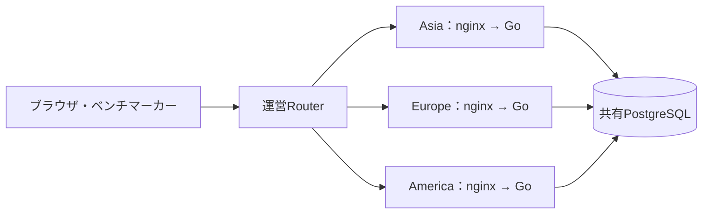
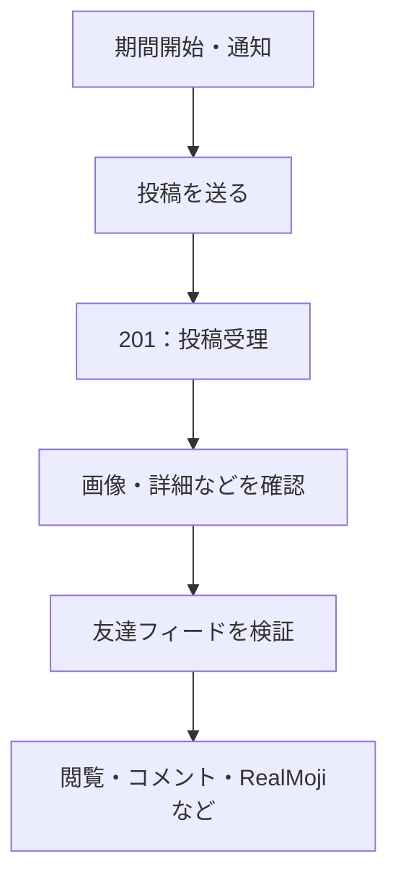

## TL;DR

- Codex（6.1 Sol）とISUCON2026に挑み、終了直前のベンチはPASS・46,281点
- DBへの往復に約100msかかる構成では、SQLを速くするだけでなく、往復そのものを減らすのが大事だった
- キャッシュ、画像処理、DB関数化、通知方式の変更などを進めたが、スコアは素直には上がらない
- 最後は「何を直すか」と同じくらい、「いま何が動いていて、何と比較しているのか」に苦しんだ

## はじめに

速くしたはずなのに、スコアが下がる。

設定を元に戻しても、スコアは戻らない。

改善をマージしたはずなのに、実機では使われていない。

つらい。

ISUCON2026に参加しました。調査や実装にはCodex（6.1 Sol）を使い、GitHubで変更を管理し、Slackで相談し、FigJamで構成や仮説を整理しながら進めました。

AIがコードを書いてくれるので、試したいことはどんどん増えます。でも、ベンチを回して、その結果を見て、採用するか判断するところは別の話でした。

この記事は、うまくいった最適化の解説に加えて、その途中でどこに詰まったのかの参加記です。

なお、46,281点は終了直前に確認したベンチの結果です。公式の最終順位や追試結果ではありません。

## 椅子のSNSを速くする

今回のお題は、椅子の写真を投稿するSNS「ISUReal」でした。

投稿、友達、フォロー、ブロック、画像、コメント、RealMoji、通知、Memories、エクスポート。SNSらしく、触るところが多いです。

アプリはGo。構成はざっくり以下です。



Asia・Europe・Americaは競技上の論理リージョンです。実際に欧州や米国へEC2を置いているわけではありません。

ただし、欧米側のアプリから共有DBへの往復には、約100msの遅延があります。

これがなかなか重い。

たとえば投稿処理で、次の5コマンドを別々に送るとします。

```text
BEGIN
  → 利用者をロック
  → 投稿期間と投稿件数を確認
  → 画像・投稿を保存
COMMIT
```

各コマンドが1往復で済んでも、通信だけで約500msです。SQLの実行時間やロック待ちは、さらに乗ります。

アプリのCPUが空いていても、DBからの返事を待っていれば遅いままです。SQLの実行計画だけ眺めていても、この待ちは消えません。

### 投稿できれば点が入る、でもなかった

もうひとつ、最適化の優先順位を考えるうえで大きかったのが採点の流れです。

[当日マニュアル](https://gist.github.com/whywaita/17f3ab1a8c1b7585c571f4f8afe5f531)では、投稿後の友達フィード検証を期間内に通過すると、通常期間は10点、最後の期間は20点。欧米には1.5倍の地域倍率があります。

つまり、投稿APIが201を返しただけでは、その投稿の加点条件を満たしたことになりません。



そこでFigJamに、操作の流れと、どこを通れば点になるのかを整理しました。

「20万点を取るには、各期間で何人が活動を終えればよいのか」という目標モデルも作りました。もちろん、計算したからその人数の負荷が来るわけではありません。あくまで、どこを速くしたいかを考えるためのものです。

投稿を受け付けるだけ速くしても、その先の画像取得やフィード確認で待たせたら、時間内に終わらない。

個々のAPIに加えて、**利用者が採点されるところまでの一連の処理**を見る必要がありました。

## やったこと

全部を細かく書くと長いので、主な施策をまとめます。

| 対象 | やったこと |
| --- | --- |
| 画像取得 | 本体のLRUキャッシュ、同時キャッシュミスの集約、DB問い合わせの統合、検索対象パーティションの限定 |
| 画像署名 | 計算結果のメモ化、URL期限を分単位に揃えて再利用 |
| ユーザー検索 | Unicode正規化結果の保存・メモ化、DBでの候補絞り込み、索引追加 |
| 認証 | 有効なセッションをキャッシュし、変更時に無効化 |
| 読み取り・更新API | 重複取得の削減、SQLの統合、DB関数化 |
| JPEG検証 | 受理・拒否と寸法の判定を保ちつつ、使わない画素復元を省く |
| 通知 | 書き込み先とロックの見直し、人数分のINSERTを省く方式への変更 |

### DBへ聞く回数を減らす

欧米側の遅延に対しては、Goから細かくSQLを送る代わりに、ロック・確認・更新をPostgreSQL関数へまとめました。

通常の成功経路で、認証を除くDBコマンド数は、投稿が5回から1回、ログインや友達申請などが4回から1回になります。

確認やロックを省略するわけではなく、DBの中で続けて実行してもらいます。長い距離を何度も往復しないようにするイメージです。

別途行ったローカル比較では、初期Go版からの改善を含む版で、次のような差が出ました。

| 指標 | 初期Go版 | 改善を含む版 |
| --- | ---: | ---: |
| 投稿の中央値 | 約1,261ms | 約221ms |
| 友達2人分の投稿後確認の中央値 | 約7,744ms | 約1,760ms |

DBへの追加RTTを100msに校正し、同じ小規模な合成データから開始した各3試行の中央値です。競技環境の高負荷を再現した実験ではなく、ほかのコード改善や索引も含むので、差全体をDB関数化の効果とは言えません。

それでも、往復を減らす方向には手応えがありました。

認証も、毎要求DBへ確認すれば、それだけで1往復です。有効なセッションをアプリ内に保持し、ログアウトや再ログインなどの変更時には、`pg_notify`で各アプリのキャッシュを無効化するようにしました。

通知を受けるLISTEN接続が切れている間はキャッシュを使わず、再接続したら空から始めます。速くなっても、ログアウトした人が使い続けられたら困るので、このあたりは必要です。

同じくローカルのDB追加遅延100msの比較では、Europeの友達フィードp50が約205msから103msになりました。

### 画像を表示しないのに、画素まで復元していた

画像処理では、CPUプロファイル上で`image/jpeg.Decode`が大きな割合を占めていました。ある実機採取では約40%です。

投稿時に必要なのは、JPEGとして受け付けられるかと、その寸法でした。復元した画素は使っていません。

画像を確認したいだけなのに、律儀に最後まで復元していたわけです。

そこで、解析とエラー判定を残しながら、使わない画素復元を省く実装へ置き換えました。元のデコーダと受理・拒否や寸法が一致するか、差分テストでも確認しています。

キャッシュでも、同じように「何を省いてよいか」が大事でした。

画像本体は覚えておけますが、その人へ画像を見せてよいかは別です。本体がキャッシュにあるからといって、現在の権限や削除状態の確認まで飛ばすわけにはいきません。

速くするたびに、どの判定を残すべきかを考える。地味ですが、ここを間違えると速いだけの別アプリになってしまいます。

## スコアが戻らないんだが

PostgreSQLの設定を調整したときは、かなり迷いました。

`shared_buffers`、`wal_buffers`、`max_wal_size`、JITの設定を変えたところ、こうなりました。

| 条件 | スコア |
| --- | ---: |
| 変更前 | 12,452 |
| 候補設定を適用してDB再起動 | 8,969 |
| 同じ候補で再測定 | 8,389 |
| 旧設定へ戻してDB再起動 | 8,949 |

全部PASSです。

設定が悪かったのかと思って戻したのに、戻らない。どうして。

ただ、4設定をまとめて変えていて、DB再起動も挟んでいます。キャッシュ状態や、ベンチが流す負荷も完全には揃っていません。

ここで言えるのは「この設定の改善は確認できなかった」まででした。点数が落ちた理由を、全部その設定のせいにはできません。

設定を戻せば数字も戻る、という期待が崩れました。

### ColdとWarmでそんなに違うのか

別の確認では、同じGo版でも次の差が出ました。

| 条件 | スコア |
| --- | ---: |
| アプリ3台とDBのOS再起動後 | 13,888 |
| 再起動せず、続けて実行 | 19,748 |

約42%違います。後者もベンチの通常の初期化は行っています。

DBの物理読み込みやiowaitにも差があり、キャッシュ状態の影響が疑われました。ただし、各1回なので、差のすべてを説明できたわけではありません。

終盤にも、アプリ再起動後は約3.1万点、続けたWarmでは約3.5万点という差がありました。こちらはアプリだけの再起動なので、OSごと再起動した場合と同じColdではありません。

Coldという一語でまとめると、プロセス内キャッシュ、DBのキャッシュ、接続ごとのSQL準備まで混ざってしまう。

改善したのか、温まったのか。その切り分けが難しかったです。

### ログを止めたら0点になった

ログ出力の費用も減らそうと、通常ログとアクセスログを止めた構成を試しました。

結果、0点。

通信エラー率が閾値を超えてFAILになり、EOFや502が出ていました。ログを減らした直後にこれなので、なかなか心臓に悪いです。

調べると、nginxの`worker_connections`が768で、接続枠不足を起こしていました。追加の診断でも、両workerが上限へ達することを確認しました。

SSEの長い接続に加えて、通常APIも流れます。nginxではクライアント側と上流側の接続を別に数えるので、利用者数だけ見ていても足りません。

接続枠を8,192、workerのFD上限を16,384へ増やした走行では、ログ停止のままPASS・約3.5万点になりました。観測したsocket FD数は最大2,563で、旧上限を超えていました。

ログ停止が接続枠不足を引き起こしたのか、そこまでの因果は分かりません。ただ、実際に足りていない接続枠は見つかりました。

変えた直後に壊れたからといって、直前の変更だけが原因とは限らない。分かっているつもりでも、競技中に冷静に考えるのは難しいです。

## 通知INSERTを消したのに、まだ遅い

投稿期間の開始も、長く追っていた箇所です。

途中の計測では、Asiaの期間開始に約4.9秒。そのうち約4.3秒が通知のINSERTでした。

開始時に人数分の通知を作っているので、利用者が増えるほど重くなります。ここで待たせると、その先の投稿や閲覧を始めるのも遅くなります。

まず、新しい通知の書き込み先を過去履歴から分け、ロックの範囲を地域単位へ見直し、期間開始用のDB接続も予約しました。

最後は、人数分の通知行を作るのをやめました。

投稿期間の1行へ、開始時点の対象者ID一覧を保存します。待受側がそこから通知を組み立て、`pg_notify`の合図で取りにいく方式です。合図を受け損ねても拾えるよう、定期監視も残しました。

ローカルの合成データでは、開始APIの中央値が約66msから13ms、通知到達p50の中央値が約354msから28msになりました。各方式5回の比較です。

ただし、実機の高負荷や4秒超の待ちを、そのローカル実験で再現できたわけではありません。

そして、最後の実機ログでは、通知INSERTはなくなっていたものの、Asiaの期間開始には最大約9.9秒かかっていました。

ほぼ全部が、前の期間を閉じて、新しい期間と対象者一覧を作るSQLの区間です。予約した接続を取得する待ちは、ほぼありませんでした。

一番長い処理を消したはずなのに、まだ長い。

ログから次に調べる場所は絞れましたが、そこをロック待ち、CPU、I/Oへ切り分けるところまでは届きませんでした。

## マージ済みです。実機では動いていません

終盤に、なかなかつらい事実も見つかりました。

書き込みAPIをDB関数へまとめる変更は、mainに入っています。しかし、実機DBには、その関数がありませんでした。

アプリは起動時に関数の有無を調べ、揃っていなければ従来の処理へ戻る設計でした。移行途中でも動くようにした結果、最適化が有効でなくても、普通に動きます。

普通に動いている。だから気づきにくい。

必要なのは、コードの配布だけではありませんでした。

1. 関数を呼ぶGoコードを配布する。
2. 対応するSQLをDBへ適用する。
3. アプリを再起動し、関数が使えることを検出させる。

ここまで揃えて、ようやく使われます。

適用と再起動の後には、その時点のBESTを更新しました。ただし、通知方式などの変更も入っていたので、増分をDB関数化だけの成果とは言えません。

「マージした」と「使われている」は、別の状態でした。

### AIが速くても、共有環境は1つしかない

AIを使うと、調査や実装を複数進められます。実際、PRには多くの案が並びました。

でも、共有DBや公式ベンチまで、好きなだけ並列に使えるわけではありません。

DB関数を適用しようとしたときも、別の再起動・起動確認が環境を使っていて、こちらは待つことになりました。保持している作業を探し、Slackで調整し、解放されてから続行しました。

待っている間にも配布版は変わります。さっき確認したコミットを前提に操作を続けると、またずれます。

AIの報告も、そのまま信じればよいわけではありませんでした。「最新のベンチ」を聞いたら、ローカルに保存された古い結果を返してきて、ポータルを確認し直した場面もあります。

コードを書く速度は上がる。でも、**いま何が動いていて、誰が環境を使い、どの結果を見ているのか**を揃える作業も増えました。

GitHub、Slack、FigJamを使っていても、勝手に話が揃うわけではありません。最後は、それぞれを突き合わせる必要がありました。

## 残り時間で、もう一度ログを取る

終盤、WebUIから実行したベンチで約4.4万点が出ました。

ここで気になったのが、ログです。WebUIから回せば、ログありで動くのか。

確認すると、アプリは`--no-logs`のまま、nginxのアクセスログも止まっていました。ベンチの起動方法を変えても、サーバー側の設定は変わりません。そりゃそうだ。

そこで最後は、一時的にログを有効にして実行しました。恒久的なsystemd設定は変えず、実行時だけのoverrideを使い、計測後に元へ戻しています。

結果は、**PASS・46,281点**。

ただ、これを「ログを有効にしたら速くなった」とは言えません。前の実行はWarmで、こちらはログ設定のためにアプリを再起動しています。比較条件が違います。

最後のログでは、投稿が実際に1回のDB関数呼び出しで処理されていること、人数分の通知INSERTがなくなっていることを確認できました。

一方、投稿APIのp95はAsiaで約3.4秒、欧米で約1.8〜1.9秒。別途取得した終盤の計測でも、DB CPUは中盤以降94〜99.8%へ達していました。

欧米との往復を減らしても、共有DBの処理量や競合、Asiaの後半の待ちは残っています。まだ速くできそうな場所はありました。

しかし、終了直前に変更して、測って、失敗したら戻す時間はありません。

最後は最新スコアと稼働状態、一時設定が戻っていることを確認して終えました。

## 次は、ちゃんと比較したい

今回、AIで実装を進めることにはかなり手応えがありました。DB往復の削減や画像処理の見直しなど、自分たちが試せた施策は多かったです。

その分、「速そうな変更」が積み上がる速さに、比較や反映の確認が追いつかない場面もありました。

次に持ち込みたいのは、この3つです。

- **比較条件を残す。** コミットだけでなく、DB変更、ログ設定、再起動の範囲と時刻も記録する。Coldを一種類だと思わない。
- **ローカルで試して判断できるようにする。** DB遅延やデータを揃え、速さと正しさを繰り返し確認できる環境を、競技前から用意する。
- **実機で使われるところまで追う。** マージ、SQL適用、配布、再起動、有効な処理経路の確認までを、変更の完了として扱う。

コードが書けたことと、競技で点になることの間には、思ったより距離がありました。

競技後、Slackには「絶望と共に希望」と書きました。

直したはずなのに点が下がるのは絶望です。でも、最後のログで、直した箇所が実際に動いていて、その先に別の待ちが残っていることは分かりました。

次に掘る場所は見えた。時間はなくなった。

次は、その先まで行きたいです。

## 参考

- [ISUCON2026 まとめ（公式）](https://isucon.net/archives/60124520.html)
- [ISUCON2026 当日マニュアル](https://gist.github.com/whywaita/17f3ab1a8c1b7585c571f4f8afe5f531)
