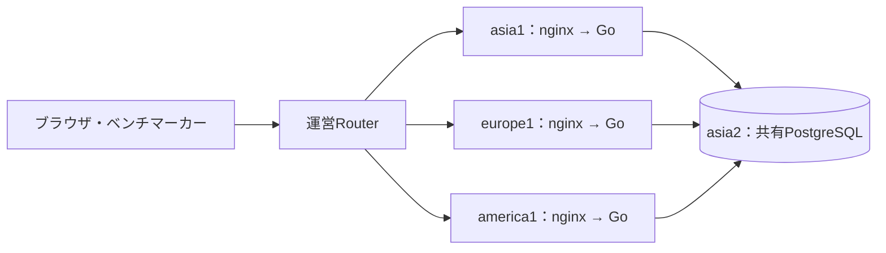
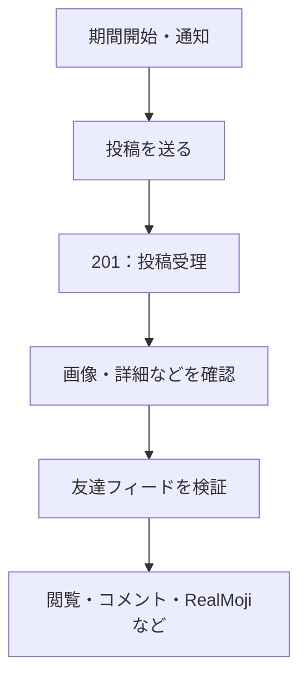

速くしたはずなのに、スコアが下がる。

設定を元に戻したのに、スコアは戻らない。

mainには改善が入っている。でも、実機ではその経路が使われていない。

ISUCON2026で一番苦しかったのは、このあたりでした。コードを変更すること以上に、**いま動いているものと、いま見ている数字が何なのかを揃えること**に時間を使いました。

調査や実装にはCodexなどのAIコーディングエージェントを使い、GitHubで変更を管理し、Slackで相談し、FigJamで構成と仮説を整理しました。終了直前に確認したベンチマークは **PASS・46,281点** でした。

この記事では、当日のPR、運用記録、Slack、FigJam、ベンチのログを突き合わせて、取り組んだ施策と判断に迷ったところを振り返ります。数値は条件を添えて書きます。ローカルで速くなった値と、競技環境で取れたスコアは分けて扱います。

:::message
本稿の46,281点は、競技終了直前に確認したベンチ #37393 の確定スコアです。公式の最終順位や追試通過までを示すものではありません。
:::

## 3地域のアプリから、1つのPostgreSQLへ

今回のお題は、椅子の写真を投稿するSNS「ISUReal」でした。投稿、友達・フォロー・ブロック、画像、コメント、RealMoji、通知、Memories、エクスポートと、触るところが多い。

アプリはGo。稼働構成は大まかに次のようになっていました。



ここでいうAsia・Europe・Americaは、競技上の**論理リージョン**です。物理的に東京・欧州・米国へEC2を置いたという意味ではありません。FigJamにも、この区別を書いていました。

欧米側のアプリから共有DBへの往復には、約100msの遅延がありました。SQLの実行が短くても、直列に送るコマンドが増えると、その分だけ待ちます。

たとえば、次の5コマンドを別々に送る投稿処理なら、各コマンドが1往復で済むと仮定しても、通信だけで約500msです。

```text
BEGIN
  → 利用者をロック
  → 投稿期間と投稿件数を確認
  → 画像・投稿を保存
COMMIT
```

初回のSQL準備、接続取得、画像の転送、ロック待ちは、さらに別に乗ります。

**CPUが空いている欧米アプリを見て「まだ余裕がある」と考えるだけでは足りない。** 直列の通信待ちを減らす必要がありました。

## まず、何を速くすると点になるのかを図にした

APIが多いので、関数を眺めているだけでは優先順位が決まりません。そこでFigJamに、ユースケース、操作の流れ、ドメインのつながりを整理しました。

特に意識したのは、投稿が受理されてから先です。



[当日マニュアル](https://gist.github.com/whywaita/17f3ab1a8c1b7585c571f4f8afe5f531)では、投稿後の友達フィード検証を期間内に通過すると、通常期間は10点、最後の期間は20点。欧米には1.5倍の地域倍率があります。

つまり、`POST /api/posts` が201を返しただけでは、その投稿の加点条件を満たしたことにはなりません。その先の検証や閲覧を、時間内に回す必要があります。

この整理から、FigJamには「20万点を、利用者の完走から逆算する」という目標モデルも作りました。投稿だけでなく、閲覧や画像取得、リアクションを含む活動一式を、各期間で何人が終えれば届くかを考えるものです。

ただし、これは**目標を分解した計算**です。ベンチの負荷人数をこちらで指定できるわけでも、表示された人数が全活動を完走した人数でもありません。

途中のベンチでは、Asiaの最終日の表示が197人、最後の投稿検証のログが37人という差がありました。同じ利用者の集合として照合できていないため、37÷197を厳密な完了率とは呼べません。それでも、「人数が増えても、最後まで回せていないのでは」という調査の入口にはなりました。

図にしたことで、考える対象が「APIを速くする」から、「利用者が採点される活動を終えるまでの経路を短くする」へ変わりました。20万点には届きませんでしたが、この整理はその後の優先順位をつける土台になりました。

## 実装したこと：計算を減らし、DB往復を減らす

当日は複数の施策を並行して進めました。主なものを整理すると、次のようになります。

| 対象 | 取り組んだこと | 気をつけたこと |
| --- | --- | --- |
| 画像取得 | 本体のLRU、同時ミスの集約、DB問い合わせの統合、検索対象パーティションの限定 | キャッシュに当たっても、現在の閲覧権限や削除状態の確認を省かない |
| 画像署名 | 同じ入力の計算結果をメモ化し、URL期限を分単位に揃えて再利用 | 有効期限と署名の検証を維持する |
| JPEG検証 | 受理・拒否と寸法の確認に必要な解析を残し、画素復元を省く | 元のデコーダとの受理・拒否、寸法の一致を確認する |
| ユーザー検索 | Unicode正規化結果の保存・メモ化、DBでの候補絞り込み、索引追加 | Go側の最終照合を残し、検索結果やページングを壊さない |
| 認証 | 有効なセッションをプロセス内に保持し、変更時に無効化 | ログアウト、再ログイン、退会、地域変更を反映する |
| 読み取り・更新API | 重複取得を省き、SQLやDB関数へまとめる | ロック順、確認する時点、エラー判定を保つ |
| 通知 | 新規通知の保存先分離、地域単位のロック、最後に人数分のINSERTを省く方式へ変更 | 開始時点の対象者と、配信時の条件を保つ |

### キャッシュは「何を覚えてよいか」が難しい

画像本体を覚えることと、画像を見せてよいという判断を覚えることは、別の設計です。削除や権限変更がある以上、本体キャッシュに当たるからといって、認可まで飛ばすわけにはいきません。

画像の署名や検索文字列の正規化は、入力が同じなら結果も同じ計算なので、メモ化の対象にしやすい。一方、セッションは状態が変わります。

認証キャッシュでは、ログアウトや旧セッションの置き換えなどと同じSQL文で`pg_notify`を送り、各アプリの保持分を無効化するようにしました。通知を受けるLISTEN接続がない間はキャッシュを使わず、再接続時には空から始めます。

ローカルの合成データ・DB追加遅延100msの比較では、Europeの友達フィードp50が約205→103ms、読み取り混合の処理件数が9.18→15.36 req/sになりました。これは公式スコアではありませんが、毎要求の認証1往復を省く効果を、実HTTPで確認できた例です。

### JPEGを「確認するためだけに復元する」のをやめる

画像処理では、CPUプロファイル上で`image/jpeg.Decode`が大きな割合を占めていました。ある実機採取では約39.8%です。

投稿時に必要なのは、JPEGとして受け付けられるかと、その寸法でした。画素を最後まで復元した結果は使っていません。

そこで、デコーダの解析・エラー判定を残しながら、画素復元に必要な処理を省く実装へ置き換えました。「JPEGの検証を雑にした」ではなく、必要な判定を維持して、使わない出力を作らない方向です。

この手の変更は、速さだけ見れば魅力的です。でも、不正な画像を通したり、これまで受け付けていた画像を拒否したりすると競技として成立しません。差分テストで元のデコーダと照らすところまで含めて、施策でした。

### DB関数化で、欧米の直列待ちを削る

更新処理では、Goから細かくSQLを送る代わりに、ロック・確認・更新をPostgreSQL関数の中へまとめました。

最後に適用した`014-write-api-functions.sql`には、次の4関数があります。

- `login_v1`
- `create_post_v1`
- `create_friend_request_v1`
- `transition_friend_request_v1`

通常の成功経路で、認証を除くDBコマンド数はログインが4→1、投稿が5→1、友達申請とその状態遷移が4→1になります。認証キャッシュに当たらない場合の問い合わせや、接続・SQL準備の費用は別です。

別途行ったローカル比較では、初期Go版と、これらを含む版の投稿後確認を比べました。追加DB RTTを100msに校正し、同じ合成データから開始した18試行の一部を抜き出すと、次のようになります。

| 最初の投稿期間の指標 | 初期Go版 | 改善を含む版＋014 |
| --- | ---: | ---: |
| 投稿の中央値 | 1,260.9ms | 220.7ms |
| 友達2人分の投稿後確認の中央値 | 7,744.3ms | 1,760.2ms |

各条件3試行の中央値を比較した値です。アプリ直結・小規模な合成データ・固定並列数での比較で、nginx、競技ルーター、高負荷時のCPU飽和は含みません。コードと対応するスキーマ・索引・関数を一式で変えているため、差全体を014だけの効果とも言えません。

それでも、長いDB往復を減らす方向には手応えがありました。

## 苦悩その1：設定を戻しても、スコアが戻らない

PostgreSQLの設定を調整したときは、かなり迷いました。

`shared_buffers`、`wal_buffers`、`max_wal_size`、JITの設定を変えたところ、ベンチは次のようになりました。

| 条件 | スコア |
| --- | ---: |
| 変更前 | 12,452 |
| 候補設定を適用してDB再起動 | 8,969 |
| 同じ候補で再測定 | 8,389 |
| 旧設定へ切り戻してDB再起動 | 8,949 |

全部PASSです。けれど、設定を戻しても12,452点には戻りませんでした。

変更後に点が落ちたので、その設定が悪かったと結論づけたくなります。でも、4設定をまとめて変えており、DB再起動も挟んでいます。キャッシュ状態や、ベンチ側が流す負荷も完全には揃っていません。

この記録から言えるのは、「この候補の改善は確認できず、旧設定へ戻した」までです。低下の全原因を設定へ帰属させることはできません。

**元に戻したのだから数字も戻ってほしい、という期待が通用しない。** ここで、比較条件を記録する必要をかなり実感しました。

## 苦悩その2：同じコードでもColdとWarmで大きく揺れる

OS再起動を含む確認でも、点数が大きく動きました。

| 条件 | ベンチ | スコア |
| --- | --- | ---: |
| 4台のOS再起動後 | #9533 | 13,888 |
| OS・サービスを再起動せず続けて実行 | #9705 | 19,748 |

同じGo版で、後者が約42%高い。後者も通常の初期化は行っています。

DBの物理読み込みやiowaitにも差があり、キャッシュ状態の影響を支持していました。ただし、単回のペアなので「全差分がキャッシュの効果」とまでは言えません。

終盤にも、同じ配布版で次の差が出ています。

| 条件 | ベンチ | スコア |
| --- | --- | ---: |
| アプリ再起動後のCold | #34728 | 31,471 |
| 続けたWarm | #35203 | 35,250 |

この2つはアプリ再起動の有無による区分です。先ほどの4台OS再起動のColdと、同じ冷え方を再現した実験ではありません。

ここで疑ったのは、プロセス内キャッシュや、接続ごとのSQL準備などでした。接続が増えれば、その接続ではまだ準備していないSQLが出てきます。100msの往復があると、その追加費用も無視しづらい。

こうした揺れを調べるため、投稿・フィードなどには要求単位のDB遅延ログも追加しました。接続取得、SQL実行、Prepare、接続生成などを分けて記録するものです。

苦しかったのは、調査したいからログが欲しい一方、観測自体にも費用があることでした。ログ有効・無効を混ぜて比較すると、説明すべき変数がまた増えます。

## 苦悩その3：ログを止めた構成で0点になった

通常ログとアクセスログを止めた構成を配布した後、#32325はFAIL・0点になりました。負荷中の通信エラー率が閾値を超え、EOFや502が出ていました。

その時間帯のnginxでは、`worker_connections 768`の接続枠不足が記録されていました。追加の診断走行では、両workerが768枠に達することも確認しました。

SSEの長い接続があり、通常APIも流れます。さらにnginxではクライアント側と上流側の接続を別に数えます。利用者数だけ見ていても、必要な接続枠は分かりません。

接続枠を8,192、workerのFD上限を16,384に調整した走行では、ログ停止のままPASS・35,098点になりました。観測したworkerのsocket FD数は最大2,563で、旧上限を超える需要がありました。

ただし、「ログを止めて処理が速くなったから接続枠を使い切った」という因果まで確定したわけではありません。ログ停止を戻すことと、観測できた接続枠不足を直すことを、混ぜずに考える必要がありました。

TCPのアイドル後のslow start設定も比較しましたが、各1回の差は35点、約0.1%でした。この差から有効・無効を決めるのは難しい。変更できる項目は多くても、判断できる実験が増えるとは限りませんでした。

## 通知INSERTを消した。でも、期間開始はまだ遅い

投稿期間の開始処理は、長く追っていた箇所です。

途中のベンチでは、Asiaの期間開始が約4.86秒、そのうち通知INSERTが約4.31秒という記録がありました。開始時に人数分の通知を作るので、ここが長いと、その後の活動を始めるまで待たせます。

段階的に、新規通知の書き込み先を過去履歴から分離し、所属変更との調整を地域単位のロックへ変え、期間開始用のDB接続も予約しました。

終盤に入った変更では、人数分の通知行をINSERTする代わりに、投稿期間1行へ開始時点の対象者ID一覧を保存します。待受側がその一覧から通知を組み立て、期間確定の`pg_notify`を受けて確認しにいく方式です。500msの定期監視は、合図を受け損ねた場合のために残します。

ローカルの合成データでは、開始API中央値が65.72→13.16ms、通知到達p50の中央値が354.13→28.39msになりました。各方式5回の比較です。ただし、実機で見えていた4秒超の遅延や高負荷を、その実験で再現できたわけではありません。

ここには、古い方式と新しい方式の共存、地域移動、退会、開始後に登録した人、通知IDの一貫性といった条件もあります。単にINSERTを消すだけの変更ではありませんでした。

最後のログでは、実際に全地域で新方式が使われ、通知INSERTの段階はなくなっていました。

それなのに、Asiaの期間開始は最大 **9,887ms**。そのうち **9,865msが`open_window`** でした。期間開始用のプール待ちは最大0.002msです。

`open_window`は、前の期間を閉じ、新しい期間と対象者一覧を作るSQLの計測区間です。通知INSERTをなくした後も、このSQLの実行や待ちが残っていました。

「一番長いところを直した」と思っても、次の長いところが出てくる。最後までそこに追いつこうとしていた感じがあります。ログだけでは、この9.9秒をロック待ち、CPU、I/Oへ配賦するところまではできませんでした。

## 苦悩その4：mainにあることと、実機で有効なことは違う

終盤に見つかった、かなり痛いずれです。

書き込みAPIのDB関数化は、GitHubではmainに入っていました。でも、実機DBには014の4関数がありませんでした。

アプリは起動時に4関数の存在を調べ、揃っていなければ従来のトランザクション経路へ戻る設計です。移行途中でも動くという利点がある一方で、**正常に動いているからこそ、最適化が有効でないことを見逃せる**。

必要なのは、次の3つでした。

1. 関数を呼ぶGoコードが配布されている。
2. 対応するSQLが共有DBへ適用されている。
3. アプリが再起動し、関数の存在を検出している。

014を適用し、3台を順に再起動した後の#36740はPASS・39,814点。その時点のBESTを更新しました。ただし、並行して通知方式なども更新されていたため、増分を014単独の効果とはしていません。

このずれは、当日のFigJamにも別の形で出ていました。構成図には「図の基準のmain」「実際の配布版」「DB拡張の適用状況」を分けて書いていました。それでも、終盤には実機をもう一度照合する必要がありました。

「マージ済みです」という報告で終わると、実行経路の確認が抜けます。次回は、変更の完了条件に**実機でどの経路が有効か**まで含めたいです。

## AIと並行作業をすると、変更よりも調整が詰まる

AIコーディングエージェントを使うと、調査や変更を複数進められます。実際、PRには多くの案が並びました。マージしたものだけでなく、別の実装に統合されて閉じた案や、最後まで保留した大きな構成変更もあります。

ただし、コードを書く作業を並列にできても、共有DBや公式ベンチを好きなだけ並列に使えるわけではありません。

014を適用しようとしたときも、別のCold/UI確認が環境の所有権を持っていました。通常のデプロイ用のロックだけでなく、OS再起動をまたいで追試を保護する予約が残っていたため、こちらの処理は止まりました。

保持している作業を調べ、Slackで調整し、解放を確認してから続けました。その間にも配布版が変わっていたので、古いコミットを前提に操作を続けず、現在の3台の配布記録とバイナリを照合し直しています。

調査の報告自体にも間違いがありました。AIへ「最新のベンチ」を尋ねたとき、ローカルに保存された古い結果を最新として返してきて、ポータルを確認し直した場面があります。

AIの作業量が増えるほど、次の情報を揃える重要性も増えました。

- どのコミットを扱っているか。
- どのSQLと設定が実機に入っているか。
- どのジョブの確定結果か。
- どのプロセスが環境を使っているか。
- 何を測り、何は測れていないか。

GitHubをコードと変更履歴、Slackを作業の共有、FigJamを構成と仮説の整理に使いました。ただ、3つあれば自動的に整合するわけではありません。突き合わせて更新するところまでが作業でした。

## 最後にログを取り直して、46,281点

終盤、WebUIから実行した#37089はPASS・44,267点でした。このとき確認したのが、「WebUIから回したらログ設定はどうなるのか」です。

ベンチの起動方法を変えても、アプリの起動引数やnginx設定は変わりません。実機は`--no-logs`のままで、アクセスログも停止していました。

そこで、最後は計測用にログを有効にして1回実行しました。恒久的なsystemd設定を書き換えず、`/run`配下の一時overrideで起動引数を変え、nginxのログも一時的に有効化しています。終了後は一時overrideを削除して再起動し、3台とも元のNoLogへ戻しました。

その#37393が、**PASS・46,281点**でした。

取得できたAPI計測ログは、3台合計29,741件。投稿APIの成功応答は次のとおりです。

| 地域 | 件数 | 平均 | p95 |
| --- | ---: | ---: | ---: |
| Asia | 687 | 1,240ms | 3,395ms |
| Europe | 260 | 986ms | 1,866ms |
| America | 232 | 983ms | 1,822ms |

集計窓は最初から最後の負荷進行ログまでで、その間に応答が完了した要求を数えています。初期化や最終検証の全区間を含むものではありません。長く開くSSEの接続時間も、通常APIの処理時間とは分けました。

DB遅延ログでは、投稿のDB関数呼び出しが1要求につき1回になっていることも確認できました。mainにあるだけだった変更が、ようやく実機の観測とつながりました。

ただし、44,267→46,281点を「ログを有効にすると速くなる」と解釈することはできません。前者はWarm、後者はログ設定変更のためアプリを再起動したColdで、計測の有無も違います。終盤に取れた2つの結果であり、一変数だけ変えた比較ではありません。

それまでの#36740でも、DB CPUは中盤以降94〜99.8%に達していました。欧米のDB往復を減らし、通知の作り方を変えても、共有DBの処理量や競合、Asiaの後半の待ちは残りました。

終了直前には、新しい変更を入れるより、最新ベンチの確定、3台のアプリとnginx、DB、一時設定の撤去を確認しました。手を入れたい場所はありましたが、その変更を測って戻せるだけの時間がありませんでした。

## 次に持ち越したいこと

次回は、変更をもっと早く書くことに加えて、**変更を比較し、捨てたり採用したりできるまでの時間**を短くしたいです。

まず、ベンチの記録へ、コミットだけでなく、DB移行、機能の有効・無効、ログ設定、アプリとDBの再起動時刻をまとめたい。Coldという一語で、OSのキャッシュとプロセス内キャッシュを一緒に扱わないようにしたいです。

ローカルの比較環境も、DB遅延の校正、合成データ、試行順序、画像・フィードの内容確認まで含めて、競技前から使える形にしておきたい。速そうな変更を大量に持つより、試して判断できる変更を増やしたいです。

そして、mainへのマージ、SQL適用、配布、再起動、有効な経路の確認を、一つの変更の完了条件として追いたい。今回の014のように、コードと実機の距離を後から発見するのはつらい。

GitHub・Slack・FigJamを振り返ると、施策そのものと同じくらい、計測条件と現在地を確認する記録が残っています。それは必要な作業でしたが、当日の限られた時間に、その仕組みから作っていた部分もありました。

競技後、Slackには「絶望と共に希望」と書きました。

46,281点まで進めても、分からないところは残りました。一方で、DB関数化が実機で動いていること、通知INSERTを消した後に別の待ちが残ることは、最後のログで確かめられました。次に掘る場所は、朝より具体的になっています。

まずは、この日に分からなかったことを、次は比較できる状態にして持ち込みたいです。

## 参考

- [ISUCON2026 まとめ（公式）](https://isucon.net/archives/60124520.html)
- [ISUCON2026 当日マニュアル](https://gist.github.com/whywaita/17f3ab1a8c1b7585c571f4f8afe5f531)

本文の実測値は、当日のベンチ結果、PRに記録したローカル比較、サービスログとAPI計測ログの集計に基づいています。個別施策の寄与を分離できていない箇所は、その旨を記載しました。
