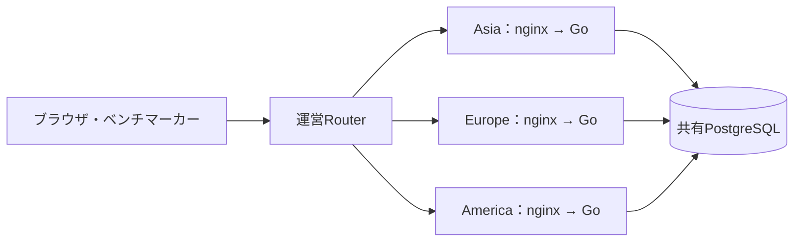
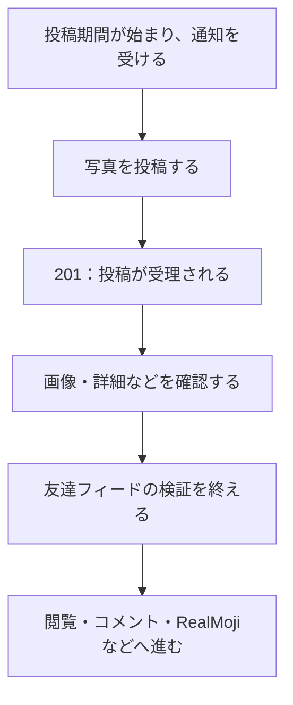

## TL;DR

- 2万点くらいまでは、Codex（6.1 Sol）の提案に沿って改善を進めると素直に伸びた
- そこから詰まり、ベンチマークの採点と利用者の行動を真面目に読み直した
- Asiaの得点をしっかり取りながら、DBが遠い欧米でも活動を回せるようにする方針へ
- 終了直前は46,281点。5万点近くまでは進んだが、上には上がいた

## はじめに

ISUCON2026に参加しました。調査や実装にはCodex（6.1 Sol）を使っています。

最初は、Agentにコードを読んでもらい、改善候補を出してもらって、それを試す。これで結構いけました。

索引を足す。無駄な取得を減らす。キャッシュする。

なるほど、速くなる。点も上がる。すごい。

2万点くらいまでは、そんな感じでした。

ところが、そこからが伸びない。変更は増えているのに、点が思ったほど増えない。速くなったはずのAPIを見ていても、次に何をすればよいのかが分からなくなってきました。

そこでようやく、ベンチマーカーが何をして、何に点をつけているのかを真面目に読み直しました。

今回の一番大きな転換は、ここだったと思います。

## まずはAgentの提案通りに進める

今回のお題は、椅子の写真を投稿するSNS「ISUReal」でした。

通知を受けて写真を投稿し、友達の投稿を見て、コメントやRealMojiを送る。友達、フォロー、ブロック、画像、Memories、エクスポートと、SNSらしく触るところが多いです。

アプリはGo。構成はざっくり以下です。



Asia・Europe・Americaは競技上の論理リージョンです。実際に欧州や米国へEC2を置いているわけではありません。ただし、欧米側のアプリから共有DBへの往復には、約100msの遅延があります。

Agentは、こういう構成やコードから改善候補を出すのがかなり速いです。

画像の有効性確認で全件走査している。フィードで必要以上の投稿を取っている。同じ情報を何度もDBへ聞いている。

実行計画やコードを確認しながら、索引追加、取得量の削減、画像キャッシュ、問い合わせの統合などを進めました。GitHubで変更を管理し、Slackで進捗を共有する形です。

昼には約2.2万点まで到達していました。

もちろん、提案を無条件で採用したわけではありません。画像本体をキャッシュしても権限確認は残す、といった正しさの確認は必要です。それでも、このあたりまでは、Agentの見つけた無駄を潰していく進め方で伸びました。

## 2万点から先は、速いAPIを増やすだけでは伸びなかった

そこから先も、改善候補は出てきます。

画像をもっと速くする。DB設定を変える。認証をキャッシュする。SQLをまとめる。

でも、それを全部やれば点が素直に増える、という感じではなくなってきました。

同じコードでも、OS再起動後は約1.4万点、続けて実行すると約2万点。設定を元に戻しても、スコアは元に戻らない。

改善したのか、温まったのか。そこから分からない。

比較条件を揃える難しさもありましたが、それ以上に、**どの処理をどこまで速くすれば得点につながるのか**を、ちゃんと説明できていませんでした。

APIの応答時間は見ている。でも、利用者がその後どこで止まっているかは見えていない。

そこで、見る単位を変えることにしました。

## ベンチマーカーの利用者は、何をしているのか

[当日マニュアル](https://gist.github.com/whywaita/17f3ab1a8c1b7585c571f4f8afe5f531)の採点を読み直すと、投稿後の友達フィード検証を期間内に通過することが、投稿の加点条件になっています。通常期間は10点、最後の期間は20点。欧米には1.5倍の地域倍率があります。

つまり、投稿APIが201を返せば、そのまま点になるわけではありません。

利用者は、だいたい次の流れで動きます。



投稿処理が速くても、通知が遅ければ投稿を始めるのが遅い。投稿後の画像取得やフィード確認が遅ければ、期間内に検証を終えられない。その後の閲覧やリアクションに使える時間も減ります。

この流れをFigJamに書き出し、何人がどこまで活動を終えれば、どのくらいの得点になるのかを逆算しました。

目標として20万点のモデルも作りました。届きませんでしたが。

それでも、ここで考え方が変わりました。

| それまで主に見ていたもの | 追加で見るようにしたもの |
| --- | --- |
| 投稿APIの応答時間 | 通知から投稿後の検証完了までにかかる時間 |
| 画像GETの速さ | 投稿した人が、その後の閲覧へ進めているか |
| 各地域の表示人数 | 人数が増えた後も、期間内に活動を終えられるか |
| 個々の改善候補 | 利用者の一連の処理で、どこが時間を使っているか |

エンドポイントの改善が不要になったわけではありません。**どのエンドポイントを優先して直すかを、ユーザー行動から決める**ようになりました。

## Asiaで取れる点を取りながら、海外もさばく

地域ごとに見ると、困り方も違いました。

AsiaはDBが近く、序盤の応答は比較的速い。一方、人数が増えた後半に、期間開始や投稿後の処理が詰まっていました。

欧米は、そもそもDBへ聞くたびに約100ms待ちます。序盤から投稿やフィード確認に時間を使い、利用者の活動を回しづらい。

欧米の倍率は高いですが、待っているだけでは点になりません。かといって、海外の改善だけを見て、人数の多いAsiaで取りこぼしても困ります。共有DBなので、どちらの負荷も同じDBへ来ます。

そこで狙ったのが、**Asiaの利用者を後半までしっかり回しながら、欧米の直列待ちも減らすこと**でした。

実装は3地域に共通するものも多いですが、どの地域の、どの行動の待ちを減らしたいのかを意識して優先順位をつけました。

### Asia：始まるまでと、投稿した後を詰まらせない

Asiaで気になったのが、投稿期間の開始です。

途中の計測では、開始処理に約4.9秒。そのうち約4.3秒が通知のINSERTでした。

開始時に人数分の通知を作るため、利用者が増えるほど重くなります。ここで数秒待つと、その先の投稿や閲覧を始めるのも遅くなります。

APIをひとつずつ速くしていても、利用者がスタート地点で待たされていたら、残り時間は増えません。

通知の書き込み先を過去履歴から分け、ロックの範囲を地域単位へ見直し、期間開始用のDB接続も予約しました。

最後は、人数分の通知行を作るのをやめました。投稿期間の1行へ開始時点の対象者ID一覧を保存し、待受側がそこから通知を組み立てます。`pg_notify`を合図に確認し、合図を受け損ねた場合には定期監視で拾う方式です。

また、投稿した後の確認や閲覧へ進めるよう、画像取得のDB問い合わせ削減、署名計算のメモ化、フィードの取得処理なども改善しました。

画像のCPU処理では、`image/jpeg.Decode`がプロファイル上の約40%を占めた採取もありました。投稿時に必要な受理・拒否と寸法の判定を残し、使っていない画素復元を省く実装へ変えています。元のデコーダとの一致は差分テストで確認しました。

期間開始、投稿、投稿後の確認。そのどこかで時間を使い切らないようにする、という見方です。

### 欧米：100msの往復を、何度も払わない

欧米側は、DBへの往復回数が重く効きます。

たとえば投稿処理で、次の5コマンドを別々に送るとします。

```text
BEGIN
  → 利用者をロック
  → 投稿期間と投稿件数を確認
  → 画像・投稿を保存
COMMIT
```

各コマンドが1往復で済んでも、通信だけで約500ms。SQLの実行時間やロック待ちは、さらに乗ります。

そこで、ロック・確認・更新をPostgreSQL関数へまとめました。通常の成功経路で、認証を除く投稿のDBコマンド数は5回から1回になります。ログインや友達申請なども同じ方向で減らしました。

確認を省略するのではなく、DBの中で続けて実行してもらいます。

認証も、毎要求DBへ聞けば1往復です。有効なセッションをアプリ内に保持し、ログアウトや再ログインなどの変更時には、各アプリのキャッシュを無効化するようにしました。

こうして、ログイン、友達作り、投稿、投稿後の確認で、少しずつ直列の待ちを削りました。

別途行ったローカル比較では、初期Go版からの改善を含む版で、次の差が出ています。

| 指標 | 初期Go版 | 改善を含む版 |
| --- | ---: | ---: |
| 投稿の中央値 | 約1,261ms | 約221ms |
| 友達2人分の投稿後確認の中央値 | 約7,744ms | 約1,760ms |

DBへの追加RTTを100msに校正し、同じ小規模な合成データから開始した各3試行の中央値です。競技環境の高負荷を再現した実験ではなく、複数のコード改善や索引も含むため、DB関数化だけの効果ではありません。

それでも、投稿APIだけでなく、投稿後の確認までをまとめて見ると、何のために往復を減らしているのかが分かりやすくなりました。

## 方針は見えたが、反映と計測でも詰まる

見たいものが分かっても、全部すんなり進むわけではありませんでした。

終盤には、mainに入っているDB関数化が、実機では有効になっていないことも見つかりました。コードは配布されていたものの、DB側の関数が未導入で、アプリは従来の処理へ戻って動いていました。

普通に動いている。だから気づきにくい。

コードをマージし、SQLを適用し、再起動して、その経路が本当に使われているかを確かめる。ここまで必要でした。

また、AIが複数の変更を進められても、共有DBや公式ベンチは好きなだけ並列に使えません。別の再起動確認が環境を使っていて待つ、保持している作業を探す、Slackで調整してから続ける、という場面もありました。

ログを止めた構成で0点になり、調べるとnginxの接続枠不足が見つかったこともあります。SSEの長い接続と通常APIが流れるので、利用者数だけ見て枠を考えていても足りませんでした。

Agentが改善案を出す速さに、比較して採否を決め、実機へ揃えて反映する作業が追いつかない。

このあたりは、当日かなり苦しかったところです。

## 5万点近くまでは来た

終了直前、ログを有効にして確認したベンチは、**PASS・46,281点**でした。

ざっくり5万点近く。2万点台で詰まっていたところからは、もう一段進めました。

ただし、スコアは複数施策を含む最終版の結果です。個々の改善が何点を増やしたかまでは分離できていません。また、公式の最終順位や追試結果とは別です。

最後のログでは、投稿が実際に1回のDB関数呼び出しで処理され、人数分の通知INSERTもなくなっていることを確認できました。

一方、Asiaの期間開始には最大約9.9秒かかっていました。ほぼ全部が、前の期間を閉じ、新しい期間と対象者一覧を作るSQLの区間でした。

通知INSERTを消しても、まだ別の待ちが残っている。

共有DBのCPUも、終盤の別の計測では中盤以降94〜99.8%へ達していました。Asiaの得点を取り切りながら海外もさばく、という方針を、十分な処理能力まで持っていくことはできませんでした。

次に掘る場所は見えた。時間はなくなった。

## 上には上がいた

競技後の社内Slackでは、上位チームが約62万点という話になっていました。

こっちは5万点近くまで来て、ようやく次に直す場所が見えてきたところです。一桁上。

上には上がいた。

事前にハーネスを作り込み、本番を自動で進めていたという話も共有されていました。ここでいうハーネスは、Agentが調査・変更・検証を繰り返すための仕組みです。

僕らが当日、ベンチの結果を探したり、反映先を照合したり、どの変更を試すか相談したりしていた部分を、事前にどこまで仕組みにしておけるか。

Agentを使うこと自体にはかなり手応えがありました。2万点くらいまでは、提案された改善を進めるだけでも伸びました。その先も、採点を理解し、ユーザー行動に沿って狙いを定めることで、もう一段進めました。

それでも、強いチームは、その改善サイクルを回す準備から違ったのかもしれません。

競技後、Slackには「絶望と共に希望」と書きました。

こんなに改善しても、上にはまだ一桁上がいるのは絶望です。でも、Agentと一緒に試せることがこれだけあり、次に準備したいものも見えたのは希望です。

次は、2万点で詰まってから採点を読むのではなく、最初から利用者が何を終えれば点になるのかを考えたい。

そのうえで、仮説を立てて、測って、直して、もう一度試すところまで、もっと速く回せる状態で持ち込みたいです。

## 参考

- [ISUCON2026 当日マニュアル](https://gist.github.com/whywaita/17f3ab1a8c1b7585c571f4f8afe5f531)
